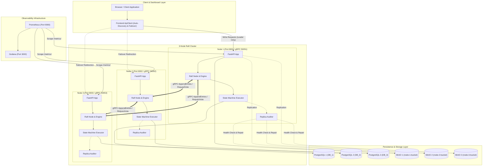
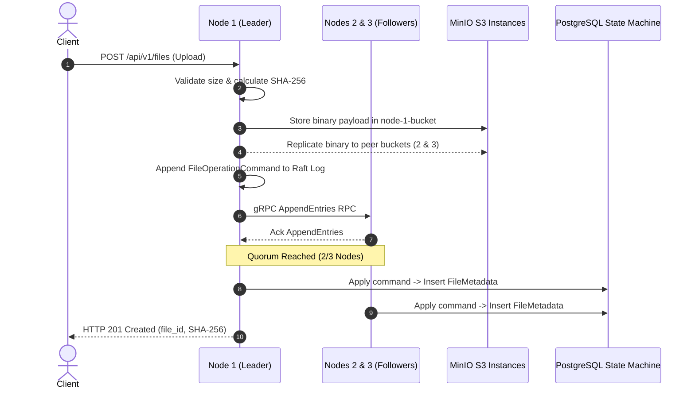

# Secure Distributed Dropbox Using Raft Consensus

[](tests/)
[](pyproject.toml)
[](backend/)
[](frontend/)
[](docker-compose.yml)
[](proto/raft.proto)

An enterprise-grade, fault-tolerant distributed file storage web application powered by a custom implementation of the **Raft Consensus Algorithm** (Ongaro & Ousterhout) built in Python, gRPC, PostgreSQL, MinIO object storage, and React.

---

## 1. Project Title and Concise Description

**Secure Distributed Dropbox Using Raft Consensus** is a resilient multi-node distributed storage platform that replicates user authentication and file metadata across a 3-node cluster using Raft consensus, while storing immutable physical files across distributed S3-compatible MinIO instances with cryptographic SHA-256 byte parity and automated background self-healing.

---

## 2. Problem Statement and Motivation

Modern distributed storage systems require high availability, partition tolerance, and strict data consistency without relying on centralized single points of failure (SPOFs). Standard single-instance repositories are prone to silent data corruption (bit-rot), process crashes, network partitions, and catastrophic data loss.

This project addresses these challenges by decoupling **metadata consensus** from **binary payload storage**:
- Metadata transactions (user accounts, permissions, file revisions, soft deletions, and audit trails) are replicated deterministically across all nodes via an in-memory and persistent Raft state machine.
- Large binary payloads are stored in distributed object stores with SHA-256 integrity checks, preventing cluster consensus bottlenecks while guaranteeing bit-for-bit file parity.

---

## 3. Project Objectives

1. **Strong Consistency for Metadata**: Ensure all cluster nodes converge deterministically on committed metadata states using the Raft consensus protocol.
2. **High Availability and Fault Tolerance**: Tolerate the failure of any single node in a 3-node cluster ($\lfloor N/2 \rfloor + 1 = 2$ quorum) without downtime or data corruption.
3. **Cryptographic Integrity & Self-Healing**: Detect and automatically repair corrupted or missing object replicas in the background using SHA-256 checksums and a continuous `ReplicaAuditor`.
4. **Transparent Client Failover**: Provide a single-page web dashboard with automatic leader discovery and non-blocking reconnects during node transitions.
5. **Defense-in-Depth Security**: Implement memory-hard Argon2id password hashing, signed HMAC-SHA256 JWT cookies, role-based access control (RBAC), and path-traversal prevention.

---

## 4. Key Features and Verification Status

| Feature | Description | Status | Verification Method |
| :--- | :--- | :---: | :--- |
| **Custom Raft Consensus Engine** | Leader election, randomized election timers (1000–2000ms), 150ms heartbeats, log replication via gRPC | **VERIFIED** | `tests/phase4`, `tests/phase5`, `tests/phase6` (20 tests PASS) |
| **Protocol Safety Enforcement** | Enforces Raft §5.2 (terms), §5.3 (log matching), §5.4.1 (election freshness), and §5.4.2 (commit rules) | **VERIFIED** | `tests/phase7/test_raft_safety_invariants.py` (10 tests PASS) |
| **Snapshotting & Log Compaction** | Truncates log at threshold, streams chunked `InstallSnapshot` RPCs to lagging followers | **VERIFIED** | `tests/phase7/test_snapshot_compaction.py`, `test_install_snapshot.py` (12 tests PASS) |
| **Three-Way Object Replication** | Multi-replica object storage across 3 dedicated MinIO instances with SHA-256 parity | **VERIFIED** | `tests/phase7/test_object_replication.py`, `scripts/verify_cross_node_uploads.py` |
| **Automated Bit-Rot Self-Healing** | Continuous background auditor repairs damaged or missing MinIO replicas from healthy peers | **VERIFIED** | `tests/phase7/test_auditor_self_healing.py` (4 tests PASS) |
| **Transactional Soft-Delete** | Atomic soft-delete commits with transactional `PendingObjectCleanup` queues drained across MinIO | **VERIFIED** | `tests/phase7/test_rename_delete_replication.py` (8 tests PASS) |
| **Authentication & Access Control** | Argon2id hashing, HttpOnly JWT cookies, multi-tenant file isolation (HTTP 403), filename sanitization | **VERIFIED** | `tests/phase1/test_auth.py`, `tests/phase7/test_security_assurance.py` (13 tests PASS) |
| **Transparent Client Failover** | Auto-discovers leader via `/api/v1/raft/cluster`, catches HTTP 503 `NOT_LEADER`, and retries seamlessly | **VERIFIED** | `tests/phase7/test_browser_and_api_workflows_e2e.py`, live cluster tests |
| **Cluster Observability Stack** | Prometheus metrics scraping (`/metrics/`) and pre-configured Grafana monitoring dashboards | **VERIFIED** | Live Prometheus targets check (`http://localhost:9090`), Grafana datasource provisioned |

---

## 5. Architecture Overview

The system runs as an 11-container topology organized into three distinct tiers:
1. **Client & Presentation Tier**: Single-page React application utilizing `apiClient.ts` with built-in node discovery, live cluster health polling, and transparent failover toast notifications.
2. **Consensus & Application Tier**: Three FastAPI/gRPC nodes. Each node runs a Raft consensus engine, an asynchronous gRPC server/client, a deterministic state machine executor, and a background `ReplicaAuditor`.
3. **Persistence Tier**: Three dedicated PostgreSQL databases (replicated via Raft state machine) and three MinIO S3 object stores (replicated asynchronously with SHA-256 validation).
4. **Monitoring Tier**: Prometheus server scraping node health and runtime metrics, paired with Grafana for live visualization.

---

## 6. Mermaid Architecture Diagram



---

## 7. Technology Stack

| Component | Technology | Version | Purpose |
| :--- | :--- | :--- | :--- |
| **Backend Framework** | Python / FastAPI / Uvicorn | Python 3.13+, FastAPI 0.115+ | REST APIs, async file streaming, dependency injection |
| **Consensus RPC** | gRPC / Protocol Buffers | `grpcio` 1.68+, `protobuf` 5.29+ | Inter-node Raft communication (`proto/raft.proto`) |
| **Relational Database** | PostgreSQL / SQLAlchemy | PostgreSQL 16 Alpine, SQLAlchemy 2.0+ | ACID transactional storage for replicated state machine |
| **Object Storage** | MinIO | Chainguard MinIO Latest | Distributed S3-compatible binary payload stores |
| **Password Security** | Argon2id | `argon2-cffi` 23.1+ | Memory-hard user password hashing |
| **Token Security** | PyJWT / Cryptography | `PyJWT` 2.10+, `cryptography` 44.0+ | HMAC-SHA256 signed access tokens and HttpOnly cookies |
| **Frontend Framework** | React / TypeScript | React 18.3, TypeScript 5.6 | Single-page responsive web dashboard |
| **Frontend Tooling** | Vite / Tailwind CSS | Vite 5.4, Tailwind CSS 3.4 | Optimized asset bundling and utility-first styling |
| **Monitoring** | Prometheus / Grafana | Prometheus v2.54.1, Grafana 11.2.0 | Metric ingestion and cluster observability dashboards |
| **Containerization** | Docker / Docker Compose | Compose Specification v2 | Multi-container networking and volume orchestration |

---

## 8. System Requirements

- **Operating System**: Windows 10/11, macOS (Apple Silicon or Intel), or Linux (Ubuntu 22.04+ recommended).
- **Docker**: Docker Desktop 24.0+ or Docker Engine with Docker Compose v2.20+.
- **Memory**: Minimum 8 GB RAM (16 GB recommended for running all 11 containers and test suites).
- **Disk Space**: At least 10 GB free disk space for container images, databases, and MinIO storage volumes.
- **Python**: Python 3.13+ (for running pytest suites or standalone scripts outside Docker).
- **Node.js**: Node.js 20+ and npm 10+ (for local frontend development).

---

## 9. Repository Directory Structure

```text
secure-raft-dropbox/
├── .env.example                                    # Environment variable template with sanitized defaults
├── .gitignore                                      # Excludes secrets, tokens, .venv, node_modules, and databases
├── docker-compose.yml                              # 11-container topology orchestration specification
├── openapi.json                                    # Complete OpenAPI 3.1 specification for all REST routes
├── pyproject.toml                                  # Backend Python packaging, dependencies, and pytest configuration
├── README.md                                       # Primary system documentation
├── docs/
│   └── TEAM_WORKFLOW.md                            # Branching strategy, PR guidelines, and team responsibility matrix
├── proto/
│   └── raft.proto                                  # Protocol Buffers definitions for Raft RPCs
├── backend/
│   ├── Dockerfile                                  # Production multi-stage container build for FastAPI node
│   └── app/
│       ├── main.py                                 # FastAPI application factory, CORS, metrics mount
│       ├── config.py                               # Pydantic Settings with environment variable overrides
│       ├── api/                                    # REST routes: auth, files, raft, health, audit
│       ├── core/                                   # Crypto, security, dependencies, audit logging
│       ├── db/                                     # SQLAlchemy engine, session maker, models (User, File, Audit)
│       ├── proto/                                  # Compiled Python gRPC stubs
│       ├── raft/                                   # Consensus engine, state, node, persistence, RPC server/client
│       ├── services/                               # Commands, state machine executor, file service, auditor
│       └── storage/                                # MinIO client and peer replication service
├── frontend/
│   ├── Dockerfile                                  # Container build for web dashboard
│   ├── package.json                                # Dependencies and scripts (tsc, vite build)
│   ├── vite.config.ts                              # Vite configuration and proxy setup
│   ├── tailwind.config.js                          # Tailwind CSS design system rules
│   └── src/
│       ├── App.tsx                                 # Main dashboard UI component
│       ├── main.tsx                                # React root entrypoint
│       └── services/apiClient.ts                   # Client-side node discovery and failover handler
├── monitoring/
│   ├── prometheus.yml                              # Prometheus scrape targets configuration
│   └── grafana/provisioning/datasources/           # Auto-provisioned Prometheus datasource for Grafana
├── reports/
│   ├── FINAL_PROJECT_VERIFICATION.md               # End-to-end architecture audit report
│   └── assurance/                                  # Formal Phase 7 assurance reports (safety, crash, partition)
├── scripts/
│   ├── scan_secrets.py                             # Automated security scanner checking for secrets
│   ├── verify_cross_node_uploads.py                # Dual-upload replication validator across all 3 nodes
│   ├── verify_live_browser_api.py                  # Live API workflow verification script
│   └── start-node-{1,2,3}.{bat,ps1}                # Local standalone node runner scripts
└── tests/
    ├── conftest.py                                 # Pytest test fixtures and temporary mock directories
    ├── phase0/ - phase6/                           # Baseline, transport, state, election, heartbeat, replication
    └── phase7/                                     # Invariants, crash-recovery, partitions, security, E2E
```

---

## 10. Installation and Local Setup

### Step 1: Clone Repository
```bash
git clone https://github.com/<your-username>/secure-distributed-dropbox-raft.git
cd secure-distributed-dropbox-raft
```

### Step 2: Configure Environment
Copy the environment template:
```bash
cp .env.example .env
```
*(On Windows PowerShell: `Copy-Item .env.example .env`)*

### Step 3: Setup Python Virtual Environment (For Local Testing)
```powershell
python -m venv .venv
.venv\Scripts\Activate.ps1
pip install -e .[dev]
```

### Step 4: Install Frontend Dependencies
```bash
cd frontend
npm install
cd ..
```

---

## 11. Environment Variable Configuration

All settings are managed via Pydantic Settings in `backend/app/config.py` with overrides loaded from `.env`:

| Variable | Default (Development) | Purpose |
| :--- | :--- | :--- |
| `NODE_ID` | `node-1` | Unique node identifier within the Raft cluster |
| `HTTP_PORT` | `8001` | Host port for FastAPI REST endpoints |
| `GRPC_PORT` | `50051` | Host port for Raft peer gRPC communication |
| `DATABASE_URL` | `postgresql://...` | Connection URI for the node's local PostgreSQL database |
| `MINIO_ENDPOINT` | `localhost:9000` | Address of the node's local MinIO instance |
| `MINIO_BUCKET` | `node-1-bucket` | Dedicated bucket name for this node |
| `JWT_SECRET_KEY` | *(Set in .env)* | 256-bit secret key used to sign session JWTs |
| `RAFT_PEERS` | `node-2:50052,node-3:50053` | Comma-delimited list of peer gRPC endpoints |
| `RAFT_ELECTION_TIMEOUT_MIN` | `1.0` | Minimum randomized election timeout in seconds |
| `RAFT_ELECTION_TIMEOUT_MAX` | `2.0` | Maximum randomized election timeout in seconds |
| `RAFT_HEARTBEAT_INTERVAL` | `0.15` | Leader heartbeat interval in seconds (150ms) |
| `SNAPSHOT_THRESHOLD` | `10` | Committed log entry count before triggering log compaction |

---

## 12. Docker Compose Startup Instructions

To launch the full 11-container topology with isolated networks and healthchecks:

```bash
# Start all containers in the background
docker compose up -d

# Verify container health status (all 11 should report 'healthy' or 'Up')
docker compose ps
```

To stop all containers safely without wiping databases or object storage:
```bash
docker compose stop
```

> [!CAUTION]
> **Data Safety**: Never execute `docker compose down -v`. The `-v` flag deletes named persistent volumes, erasing all committed Raft logs, PostgreSQL databases, and stored MinIO files.

---

## 13. Frontend and Backend Startup Instructions

### Running the Frontend Dashboard Locally
```bash
cd frontend
npm run dev
```
Open **[http://localhost:5173](http://localhost:5173)** in your browser. The dashboard automatically scans ports 8001, 8002, and 8003 to identify the current leader and display live node telemetry.

### Running Individual Backend Nodes Locally (Outside Docker)
Pre-configured scripts set `PYTHONPATH=backend` and `PHASE=phase-7`:

```powershell
# In terminal 1:
.\scripts\start-node-1.ps1

# In terminal 2:
.\scripts\start-node-2.ps1

# In terminal 3:
.\scripts\start-node-3.ps1
```

---

## 14. API Overview (Actual Registered Routes)

### Health & Diagnostics
- `GET /api/v1/health` — Node identifier, health status, service phase, ports, configured peers.
- `GET /api/v1/raft/cluster` — Live Raft role (`LEADER`, `FOLLOWER`, `CANDIDATE`), current term, active leader ID, voted_for, heartbeat status, and peer latency measurements.

### Authentication
- `POST /api/v1/auth/register` — Register a new user account (committed across all nodes via Raft).
- `POST /api/v1/auth/login` — Authenticate credentials; returns JWT in body and sets secure `HttpOnly` cookie.
- `POST /api/v1/auth/logout` — Invalidate session cookie.
- `GET /api/v1/auth/me` — Retrieve profile of the currently authenticated user.

### Distributed File Operations
- `GET /api/v1/files` — List active files owned by the authenticated user.
- `POST /api/v1/files` — Upload file multipart. *(Leader only; followers return HTTP 503 `NOT_LEADER`).*
- `GET /api/v1/files/{file_id}/download` — Stream physical file binary from MinIO with ownership check.
- `PATCH /api/v1/files/{file_id}` — Rename file metadata through Raft consensus.
- `DELETE /api/v1/files/{file_id}` — Soft-delete file metadata and schedule durable object cleanup.

### Observability
- `GET /metrics/` — Prometheus-formatted application and runtime metrics.

---

## 15. Authentication and Authorization Overview

1. **Password Hashing**: User passwords are encrypted with memory-hard **Argon2id** (`time_cost=3`, `memory_cost=65536KiB`, `parallelism=4`). Salt generation is cryptographically random and unique per user.
2. **Replicated Registration**: Unlike traditional applications where registration hits a single database, `POST /api/v1/auth/register` constructs a `RegisterUserCommand` that is replicated through Raft and committed across all three PostgreSQL databases before returning HTTP 201.
3. **Session Management**: Successful authentication returns an HMAC-SHA256 JWT in both the JSON payload and a secure `HttpOnly`, `SameSite=Lax` cookie (`access_token`).
4. **Access Control (RBAC)**: All file operations validate that the authenticated user owns the targeted resource (`user_id == current_user.id`). Administrative accounts (`role == ADMIN`) have cross-tenant access for audit and maintenance purposes.
5. **Path Traversal Neutralization**: All uploaded filenames are stripped of relative path components (`../`, `..\\`) and sanitized before database insertion.

---

## 16. Raft Leader Election and Replication Explanation

This project implements the Raft consensus protocol as defined by Diego Ongaro and John Ousterhout:

1. **Leader Election (§5.2)**:
   - Followers reset their election timer whenever they receive a valid heartbeat from the leader.
   - Election timeouts are randomized between 1000ms and 2000ms to minimize split votes.
   - When a timer expires, the node transitions to `CANDIDATE`, increments `current_term`, votes for itself, and broadcasts `RequestVote` RPCs.
   - Candidates must satisfy log completeness invariants (§5.4.1): peers deny votes if the candidate's log is less up-to-date.
   - A candidate receiving a majority of votes ($\ge 2$ in a 3-node cluster) becomes `LEADER` and begins broadcasting heartbeats every 150ms.

2. **Log Replication (§5.3)**:
   - Clients send write proposals exclusively to the leader.
   - The leader appends the command to its local log and broadcasts `AppendEntries` RPCs to followers.
   - Each follower validates consistency: `prev_log_index` and `prev_log_term` must match. Conflicting uncommitted entries are truncated.
   - Once a quorum of followers acknowledges the entry, the leader advances its `commit_index` and applies the entry to the state machine.
   - Raft invariant §5.4.2 is strictly enforced: a leader never commits log entries from previous terms by counting replicas; entries must be committed indirectly through an entry from the current term.

3. **Log Compaction & Snapshots (§7)**:
   - When the log exceeds `SNAPSHOT_THRESHOLD` (10 entries), the node takes an atomic snapshot of its state machine and truncates obsolete log entries.
   - Lagging followers that fall behind the leader's truncated log receive the state snapshot via unary chunked `InstallSnapshot` RPCs.

---

## 17. Distributed Storage and Metadata Architecture



- **Metadata Consensus**: File records (`FileMetadata`, `FileVersion`) and state changes are executed strictly through the Raft state machine.
- **Idempotency Guarantee**: Follower state machines verify command fingerprints (`AppliedCommand`) to prevent duplicate execution during network retries or leader transitions.
- **Self-Healing Auditor**: The background `ReplicaAuditor` continuously scans MinIO buckets. If a replica is missing or its hash differs from the committed metadata in PostgreSQL, the auditor downloads the healthy binary from a peer and restores the damaged object automatically.
- **Durable Cleanup**: Deletions perform an atomic soft-delete in PostgreSQL and queue a `PendingObjectCleanup` task. The auditor drains the queue by deleting physical objects across all 3 MinIO instances.

---

## 18. Monitoring and Observability

The cluster includes an automated monitoring stack:

- **Prometheus (Port 9090)**:
  - Scrapes the `/metrics/` endpoint on all three nodes (`node-1:8001`, `node-2:8002`, `node-3:8003`) every 10 seconds.
  - Monitors Raft terms, commit indices, peer ping latencies, and HTTP response distributions.
  - Access Prometheus targets: **[http://localhost:9090/targets](http://localhost:9090/targets)**.
- **Grafana (Port 3000)**:
  - Automatically provisions Prometheus as the default datasource on container launch via `monitoring/grafana/provisioning/datasources/prometheus_datasource.yml`.
  - Default credentials: `admin` / `admin`.
  - Access Grafana: **[http://localhost:3000](http://localhost:3000)**.

---

## 19. Automated Testing and Verification Instructions

### Running Full Test Regression
The project includes a comprehensive 130-test suite executed using pytest:

```powershell
# Set PYTHONPATH and run full test suite
$env:PYTHONPATH='backend'; .venv\Scripts\python.exe -m pytest -v
```

### Targeted Test Suites
```powershell
# 1. Raft Safety Invariants (10 tests)
$env:PYTHONPATH='backend'; .venv\Scripts\python.exe -m pytest -v tests/phase7/test_raft_safety_invariants.py

# 2. Crash and Recovery Assurance (3 tests)
$env:PYTHONPATH='backend'; .venv\Scripts\python.exe -m pytest -v tests/phase7/test_crash_and_restart_assurance.py

# 3. Network Partition & Quorum Assurance (5 tests)
$env:PYTHONPATH='backend'; .venv\Scripts\python.exe -m pytest -v tests/phase7/test_network_partition_assurance.py

# 4. Data Integrity & Bit-Rot Self-Healing (3 tests)
$env:PYTHONPATH='backend'; .venv\Scripts\python.exe -m pytest -v tests/phase7/test_data_integrity_assurance.py

# 5. Security & RBAC Assurance (7 tests)
$env:PYTHONPATH='backend'; .venv\Scripts\python.exe -m pytest -v tests/phase7/test_security_assurance.py
```

### Live Cluster Verification Scripts
```powershell
# Validate dual uploads, failover consistency, and SHA-256 byte parity across all 3 nodes
.venv\Scripts\python.exe scripts/verify_cross_node_uploads.py

# Scan repository for hardcoded secrets or credentials
.venv\Scripts\python.exe scripts/scan_secrets.py
```

### Frontend Typechecking and Production Build
```bash
cd frontend
npx tsc -b
npm run build
cd ..
```

---

## 20. Known Limitations and Future Improvements

1. **Fixed Cluster Membership**: The cluster currently operates with a fixed 3-node topology defined in `RAFT_PEERS`. Dynamic joint-consensus membership changes (Raft §6) without cluster reconfiguration are planned for future versions.
2. **Single-Host Simulation**: Docker Compose maps all three nodes to distinct ports on a single host. Wide-Area Network (WAN) latency and asymmetric routing are validated via software mock fixtures.
3. **Inter-Node Transport Security**: In this academic release, inter-node gRPC channels use insecure transport within the Docker bridge network. Production deployments across untrusted networks should enable mutual TLS (mTLS) with internal certificate authorities.

---

## 21. Git Branch and Pull-Request Workflow

The project uses a structured technical feature-branch workflow. Personal names are never used in branch names.

### Primary Branches
- `main` — Production-grade, reviewed, passing all test suites.
- `feature/raft-consensus` — Consensus algorithm, gRPC communication, leader election, log replication.
- `feature/distributed-storage` — MinIO object stores, PostgreSQL metadata, replica self-healing, cleanup.
- `feature/auth-and-access-control` — User authentication, Argon2id, JWT cookies, RBAC, audit logging.
- `feature/web-dashboard` — React 18, TypeScript, Tailwind CSS, node discovery, failover UX.

### Pull Request & Review Protocol
- Direct pushes to `main` are restricted.
- All code changes require a feature branch, passing regression tests (`pytest -v`), and at least one approved peer review.
- For complete branching instructions, commit standards, and merge protocols, refer to **[docs/TEAM_WORKFLOW.md](docs/TEAM_WORKFLOW.md)**.

---

## 22. Security and Responsible-Use Notes

- **Credentials & Secrets**: Never commit real secret keys, database passwords, or JWT secrets to Git. Always use `.env.example` as a template and configure local `.env` files that remain excluded by `.gitignore`.
- **Educational & Research Purpose**: This software was developed for academic study and engineering demonstration of distributed systems and consensus protocols.
- **Security Scans**: The repository includes `scripts/scan_secrets.py` to ensure zero production keys or sensitive tokens are stored in tracked files.

---

## 23. License Section

This project is developed for educational, academic demonstration, and distributed systems research purposes.

Specific licensing terms (e.g., MIT, Apache 2.0) are subject to mutual agreement by the project team members (**Chirag Kochar**, **Prem Palhade**, **Ram Rajurkar**, and **Atharva Gaikwad**) prior to public distribution.

---

## 24. Team Members & Contributors

This project was engineered and maintained by:

- **Chirag Kochar**
- **Prem Palhade**
- **Ram Rajurkar**
- **Atharva Gaikwad**

*For technical workflow guidelines and subsystem responsibility mappings, refer to [docs/TEAM_WORKFLOW.md](docs/TEAM_WORKFLOW.md).*
