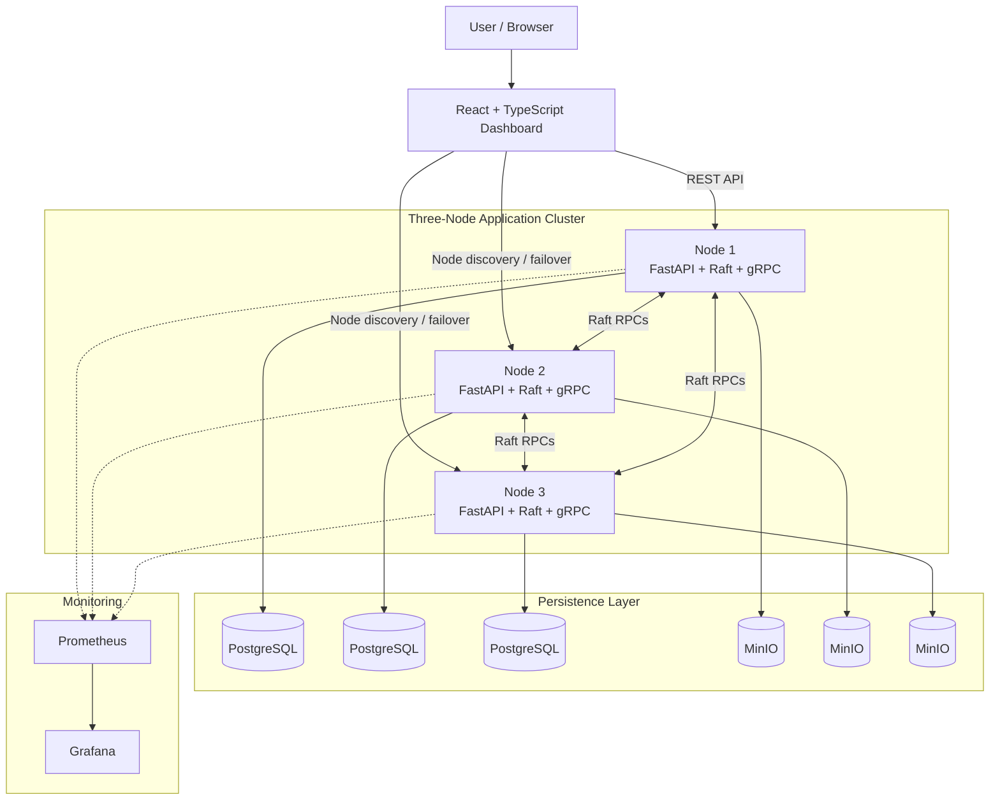

# 🔐 Secure Distributed Dropbox Using Raft Consensus

<p align="center">
  A distributed file storage platform exploring consensus, fault tolerance, secure access, and replica recovery.
</p>

<p align="center">
  
  
  
  
  
  
</p>

---

## 🚀 Overview

**Secure Distributed Dropbox** is a multi-node file storage application built around a custom implementation of the **Raft consensus algorithm**. It combines a FastAPI backend, a React dashboard, PostgreSQL metadata storage, and MinIO object storage to explore how distributed systems maintain consistency, handle node failures, and protect user data.

The system separates metadata coordination from file-object storage, using Raft for replicated state changes and object-storage services for file content.

## ✨ Key Features

- **Raft Consensus:** Leader election, term management, log replication, and quorum-based commitment.
- **Distributed File Storage:** MinIO-based object storage with file-integrity checks and replica-recovery mechanisms.
- **Secure Authentication:** Argon2id password hashing, JWT-based sessions, and role-based access control.
- **Transparent Failover:** Frontend node discovery and handling of leader changes.
- **Monitoring & Observability:** Prometheus metrics and Grafana dashboards.
- **Automated Testing:** Test suites covering consensus safety, authentication, replication, and recovery.

## 🏗️ System Architecture

The application consists of a React frontend, three cooperating application nodes, persistent storage services, and a monitoring stack.



### How it works

1. **Client requests:** The web dashboard communicates with the backend through REST APIs.
2. **Consensus:** Application nodes exchange Raft RPCs to coordinate leader election and replicate state-changing commands.
3. **Metadata persistence:** PostgreSQL stores application metadata and state-machine results.
4. **Object storage:** MinIO stores file content, with replication and integrity-recovery mechanisms implemented by the application.
5. **Observability:** Prometheus collects metrics, which Grafana can visualize.

*The diagram represents the intended logical architecture. Actual runtime behavior depends on the configured services and deployment environment.*

## 🛠️ Technology Stack

| Layer | Technologies |
|---|---|
| Backend | Python, FastAPI, Uvicorn |
| Consensus & Communication | Raft, gRPC, Protocol Buffers |
| Frontend | React, TypeScript, Vite |
| Metadata Database | PostgreSQL, SQLAlchemy |
| Object Storage | MinIO |
| Authentication | Argon2id, JWT, RBAC |
| Monitoring | Prometheus, Grafana |
| Containerization | Docker, Docker Compose |
| Testing | Pytest |

## ⚙️ Getting Started

### Prerequisites

- Git
- Docker Desktop with Docker Compose
- Python 3.13+ for local testing
- Node.js 20+ for frontend development

### 1. Clone the repository

```bash
git clone https://github.com/chiragkochar89/secure-distributed-dropbox.git
cd secure-distributed-dropbox
```

### 2. Configure environment variables

On Windows PowerShell:

```powershell
Copy-Item .env.example .env
```

Review the `.env` file and configure the credentials and service settings required by your local environment. Never commit real secrets.

### 3. Start the application

```bash
docker compose up -d
```

Check the container status:

```bash
docker compose ps
```

### 4. Stop the application

```bash
docker compose stop
```

> **Data safety:** Avoid `docker compose down -v` unless you intentionally want to remove the persistent volumes and their stored data.

## 🧪 Testing

Install the development dependencies:

```bash
python -m pip install -e ".[dev]"
```

On Windows PowerShell, set the backend import path and run the tests:

```powershell
$env:PYTHONPATH = "$PWD\backend"
python -m pytest -v
```

The repository includes targeted tests and verification scripts for consensus safety, crash recovery, network partitions, security, and distributed storage. Test results should be reported with the corresponding execution environment and latest run.

## 🔌 API Overview

| Endpoint | Purpose |
|---|---|
| `GET /api/v1/health` | Node health information |
| `GET /api/v1/raft/cluster` | Cluster and Raft status |
| `/api/v1/auth/` | Authentication operations |
| `/api/v1/files` | File management operations |
| `GET /metrics/` | Application metrics |

For the complete API specification, see [`openapi.json`](openapi.json).

## 📊 Monitoring

When the monitoring services are running and their ports are configured as expected:

- **Prometheus:** [http://localhost:9090](http://localhost:9090)
- **Grafana:** [http://localhost:3000](http://localhost:3000)

Use your configured Grafana credentials. Replace development defaults before any non-local deployment.

## ⚠️ Limitations

- The cluster uses a fixed three-node configuration.
- The default Docker Compose deployment runs on a single host; it does not by itself demonstrate multi-machine fault tolerance.
- Inter-node gRPC transport requires additional security hardening for untrusted networks.
- Replication, recovery, and failover guarantees should be evaluated against the current implementation and its tests.

## 👥 Team

- Chirag Kochar
- Prem Palhade
- Ram Rajurkar
- Atharva Gaikwad

See [`docs/TEAM_WORKFLOW.md`](docs/TEAM_WORKFLOW.md) for branch assignments and collaboration guidelines.

## 📄 License

The project team has not yet finalized a formal open-source license. Please contact the contributors regarding reuse and redistribution.
