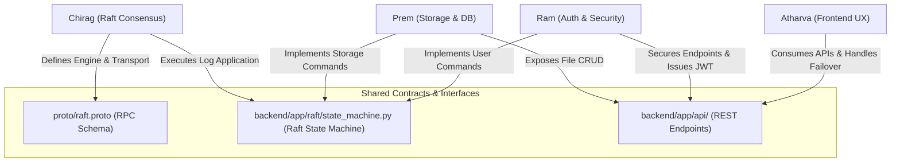
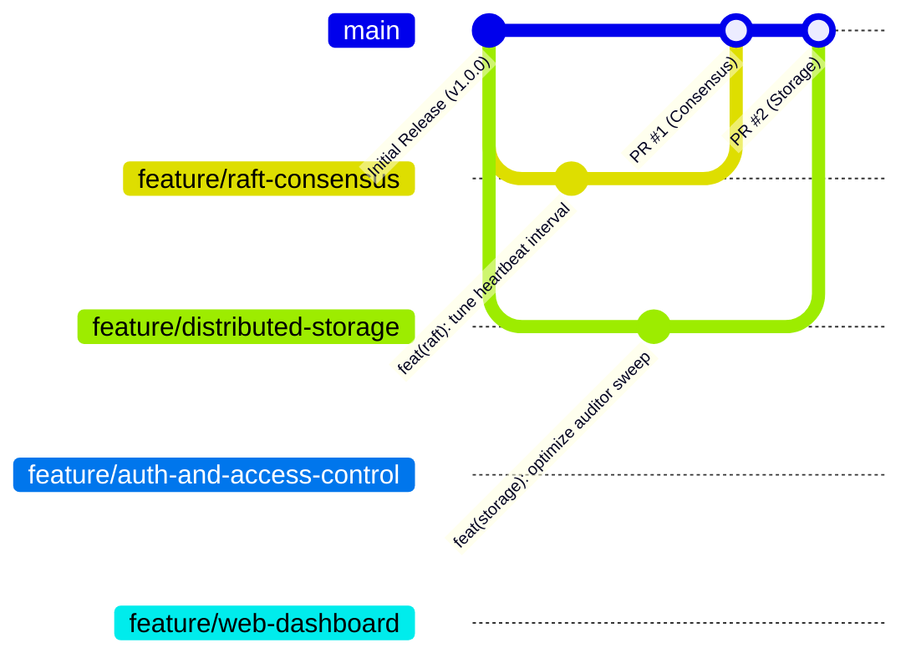

# Team Workflow & Engineering Collaboration Guide

**Project:** Secure Distributed Dropbox Using Raft Consensus  
**Repository:** `secure-raft-dropbox`  
**Audience:** Four-Member Engineering Team, Reviewers, Faculty, and External Contributors

---

## 1. Overview and Core Principles

This document establishes the engineering practices, Git branching strategy, code review protocol, and responsibility assignments for the **Secure Distributed Dropbox Using Raft Consensus** project.

### Core Principles
1. **Technical Branch Naming**: Never include personal names or initials in Git branch names. All branches must describe technical subsystems, capabilities, or fixes.
2. **Main Branch Stability**: The `main` branch represents verified, production-grade code. Direct commits to `main` are restricted. All changes land in `main` exclusively through peer-reviewed Pull Requests (PRs).
3. **Reproducible Verification**: Every change must pass automated backend regression tests (130/130 passing) and frontend production builds (`npm run build`) before merging.
4. **Credential and Privacy Hygiene**: Never commit environment files (`.env`), session tokens (`cookies.txt`), test artifacts, or private cryptographic keys to Git.

---

## 2. Team Members and Proposed Responsibility Mapping

The engineering team consists of four members. To ensure efficient parallel progress and clear accountability, the major subsystems of the repository are mapped to specific technical branches.

> [!NOTE]
> **Proposed Mapping Status**: The following assignment is proposed based on codebase architecture and module cohesion. It is subject to team review and confirmation.

### Responsibility Matrix

| Team member | Primary technical branch | Main responsibilities | Relevant directories | Verification |
| :--- | :--- | :--- | :--- | :--- |
| **Chirag Kochar** *(Proposed)* | `feature/raft-consensus` | Raft consensus engine, gRPC Protocol Buffers RPCs (`RequestVote`, `AppendEntries`, `InstallSnapshot`), leader election with randomized timeouts, heartbeats, log replication, snapshotting & log compaction, and cluster health diagnostics API (`/api/v1/raft/cluster`). | • `proto/raft.proto`<br>• `backend/app/proto/`<br>• `backend/app/raft/`<br>• `backend/app/api/raft.py` | `pytest tests/phase2/ tests/phase3/ tests/phase4/ tests/phase5/ tests/phase6/ tests/phase7/test_raft_safety_invariants.py tests/phase7/test_snapshot_compaction.py` |
| **Prem Palhade** *(Proposed)* | `feature/distributed-storage` | 3-way distributed object storage across MinIO instances, PostgreSQL metadata persistence, deterministic command application (`AppliedCommand` idempotency), cryptographic SHA-256 integrity validation, background self-healing `ReplicaAuditor`, transactional soft-delete, and durable cleanup (`PendingObjectCleanup`). | • `backend/app/storage/`<br>• `backend/app/services/`<br>• `backend/app/db/models/file.py`<br>• `backend/app/api/files.py` | `pytest tests/phase1/test_files.py tests/phase7/test_object_replication.py tests/phase7/test_auditor_self_healing.py tests/phase7/test_rename_delete_replication.py tests/phase7/test_data_integrity_assurance.py`<br>`python scripts/verify_cross_node_uploads.py` |
| **Ram Rajurkar** *(Proposed)* | `feature/auth-and-access-control` | User authentication, replicated user registration via Raft, Argon2id password hashing, HMAC-SHA256 JWT cookie issuance (`access_token` HttpOnly), FastAPI dependency injection security (`get_current_user`), Role-Based Access Control (RBAC), multi-tenant file ownership isolation, audit logging (`AuditLog`), and input validation. | • `backend/app/api/auth.py`<br>• `backend/app/api/audit.py`<br>• `backend/app/core/`<br>• `backend/app/db/models/user.py`<br>• `backend/app/db/models/audit.py` | `pytest tests/phase1/test_auth.py tests/phase7/test_security_assurance.py tests/phase7/test_user_registration_replication.py`<br>`python scripts/scan_secrets.py` |
| **Atharva Gaikwad** *(Proposed)* | `feature/web-dashboard` | React 18, TypeScript, Tailwind CSS, and Vite single-page dashboard, automatic node discovery (`apiClient.ts`), transparent client-side failover during leader election, live cluster status cards (nodes, terms, roles, latency), file management UI (upload, download, rename, soft-delete, versioning), and non-blocking toast notifications. | • `frontend/src/`<br>• `frontend/package.json`<br>• `frontend/vite.config.ts`<br>• `frontend/tailwind.config.js` | `cd frontend && npx tsc -b && npm run build`<br>`pytest tests/phase7/test_browser_and_api_workflows_e2e.py`<br>`python scripts/verify_live_browser_api.py` |

---

## 3. Cross-Module Collaboration & Shared Interfaces

Certain critical subsystems span multiple functional areas. The following protocols govern changes to shared interfaces:



### Shared Ownership Protocols:
1. **Raft State Machine Commands (`backend/app/services/commands.py` & `backend/app/raft/state_machine.py`)**:
   - Both Auth (`RegisterUserCommand`) and Storage (`FileOperationCommand`, `PendingObjectCleanup`) commit entries through the Raft log.
   - Any modifications to command serialization or state machine execution require mutual review between **Chirag**, **Prem**, and **Ram**.
2. **API Endpoint Contracts & Error Formats**:
   - The frontend `ApiClient` relies on exact status codes (e.g., HTTP 503 `NOT_LEADER` with `{"error": "NOT_LEADER", "leader_id": "<id>"}`).
   - Any change to REST endpoint return types or error contracts requires consultation with **Atharva**.
3. **Database Schema Migrations**:
   - Any new column or table on PostgreSQL models requires verification across all three nodes (`dropbox_db_1`, `dropbox_db_2`, `dropbox_db_3`) and regression verification against `tests/phase7/`.

---

## 4. Git Branching Strategy

The repository follows a clean, technical feature-branch workflow.



### 1. The `main` Branch
- Holds the single source of truth for working, verified production code.
- Protected against force-pushes (`git push --force`) and direct commits.
- Tagged with semantic version releases (`v1.0.0`, `v1.1.0`).

### 2. The Four Primary Feature Branches
These long-lived technical branches correspond to the core modules of the project:
1. `feature/raft-consensus`
2. `feature/distributed-storage`
3. `feature/auth-and-access-control`
4. `feature/web-dashboard`

### 3. Short-Lived Task Branches
For isolated bug fixes, documentation, or targeted investigations, team members may branch off their primary feature branch or off `main`:
- `fix/metadata-consistency`
- `fix/file-integrity`
- `test/cluster-recovery`
- `docs/github-setup`

---

## 5. Daily Git Workflow Guide

### Step 1: Synchronizing with Latest `main`
Before starting work on any feature or fix, ensure your local `main` is updated:

```bash
git checkout main
git pull origin main
```

### Step 2: Switching to or Creating Your Technical Branch
To switch to an existing technical branch:

```bash
git checkout feature/<branch-name>
git pull origin feature/<branch-name>
```

To create a new task branch off updated `main`:

```bash
git checkout -b fix/metadata-consistency main
```

### Step 3: Making Atomic, Documented Commits
Follow the **Conventional Commits** specification:
- `feat: <description>` — A new feature
- `fix: <description>` — A bug fix
- `test: <description>` — Adding or refactoring automated tests
- `docs: <description>` — Documentation changes
- `refactor: <description>` — Code change that neither fixes a bug nor adds a feature
- `chore: <description>` — Tooling, dependency, or configuration updates

Example:
```bash
git add backend/app/raft/engine.py
git commit -m "feat(raft): add dynamic peer latency calculation to cluster diagnostics"
```

### Step 4: Pre-Commit Quality Checks
Before pushing to remote or opening a PR, always execute the automated verification suite:

```powershell
# 1. Run backend regression tests
$env:PYTHONPATH='backend'; .venv\Scripts\python.exe -m pytest -v

# 2. Run frontend typecheck and production build
cd frontend
npx tsc -b
npm run build
cd ..

# 3. Verify no secrets or sensitive files are staged
python scripts/scan_secrets.py
git status
```

### Step 5: Pushing and Opening a Pull Request
Push your branch to GitHub:

```bash
git push -u origin feature/<branch-name>
```

Open a Pull Request on GitHub targeting `main`:
- **PR Title**: `feat(module): brief imperative description`
- **PR Description**: Include:
  1. Summary of changes made.
  2. Motivation and design rationale.
  3. Evidence of test execution (e.g., `pytest` output or build status).
  4. Any cross-module impact.

---

## 6. Code Review and Merge Protocol

### Review Requirements
- Every PR must receive at least **one approved review** from a peer before merging.
- If a PR alters shared interfaces (`proto/raft.proto`, `backend/app/raft/state_machine.py`, or `backend/app/api/`), the designated owners of dependent modules must review and approve.

### Reviewer Checklist:
- [ ] Does the code adhere to project architectural conventions?
- [ ] Are all new functions typed and documented?
- [ ] Do all 130 regression tests pass locally without warnings?
- [ ] Does `npm run build` succeed with zero errors?
- [ ] Are all database operations safe and idempotent?
- [ ] Is error handling robust (graceful HTTP error codes rather than unhandled 500s)?
- [ ] Are zero secrets, session files, or local `.env` values included in the diff?

### Resolving Merge Conflicts
If `main` has progressed while your branch was being developed:

```bash
# Update local main
git checkout main
git pull origin main

# Switch to your branch and rebase on main
git checkout feature/<branch-name>
git rebase main

# If conflicts occur, resolve them in your editor, stage the resolved files, and continue:
git add <resolved-file>
git rebase --continue

# Re-run all tests to ensure the rebase is green
$env:PYTHONPATH='backend'; .venv\Scripts\python.exe -m pytest -v

# Push the rebased branch (use --force-with-lease on feature branch ONLY, never on main)
git push --force-with-lease origin feature/<branch-name>
```

### Merging to `main`
- Use GitHub's **Squash and Merge** (or **Rebase and Merge**) to keep the commit history on `main` clean and linear.
- Delete the feature branch on GitHub once successfully merged.

---

## 7. Security and Secret Prevention

### Golden Rules:
1. **Never commit `.env`**: Always use `.env.example` with sanitized placeholders.
2. **Never commit `cookies.txt`**: This file contains live JWT session tokens from verification runs.
3. **Never commit `dropbox.db`**: Local SQLite files used during tests are automatically generated and must not be tracked.
4. **Never disable `.gitignore` rules**: Always inspect `git status` before `git add .`.

### What to do if a secret is accidentally committed locally:
If a secret was committed locally **but not pushed to GitHub**:
```bash
# Undo the last commit while keeping your file modifications in the working tree
git reset --soft HEAD~1
# Unstage the secret file and ensure it is in .gitignore
git reset HEAD path/to/secret-file
```

If a secret was **already pushed to GitHub**:
1. Immediately treat the credential as compromised.
2. Revoke and rotate the compromised password, secret key, or token immediately.
3. Notify the team and rewrite the commit history using `git filter-repo` or BFG Repo-Cleaner before publishing further.

---

## 8. Recommended Screenshots Guide

When preparing repository visual assets for documentation or presentation:

| Target Screenshot | Recommended Location | Content to Capture | Privacy Precautions |
| :--- | :--- | :--- | :--- |
| **Cluster Topology Dashboard** | `docs/images/cluster_dashboard.png` | Frontend view showing all 3 nodes (Node 1, Node 2, Node 3), their active roles (Leader / Follower), current terms, and peer latencies. | Ensure no sensitive file names are displayed in the file list. |
| **File Management Interface** | `docs/images/file_management.png` | File list showing uploaded items, sizes, version badges, SHA-256 hashes, and action buttons (Download, Rename, Delete). | Use generic academic test files (e.g., `document-v1.pdf`, `dataset.csv`). |
| **Failover Notification** | `docs/images/failover_toast.png` | Toast alert notification showing automatic redirection from a crashed node to the newly elected leader without session loss. | Capture standard browser viewport. |
| **Prometheus & Grafana** | `docs/images/grafana_monitoring.png` | Grafana dashboard showing Prometheus metrics (Raft term, peer ping latency, HTTP request throughput). | Standard Grafana dashboard layout. |

> [!WARNING]
> When capturing screenshots:
> - Never capture browser address bars displaying authorization headers or raw tokens.
> - Never capture terminal windows containing secret `.env` exports or passwords.
> - Crop out local OS user paths (`C:\Users\<username>\...`) from screenshots where visible.
